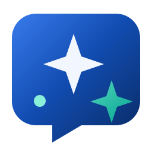

# My AI

A place to ask questions, explore ideas and work on your code projects. Chat with models on your own PC through Ollama, or connect your OpenAI and DeepSeek API accounts.

Download the [Windows portable app](https://github.com/oneworkspacestudio/my-ai/releases). Open MyAI.exe to get started. With One Workspace, use your MyAccounts sign-in and keep conversations in your private My Drive area.

Choose a provider and model in each conversation. Models shows local models first, with expandable OpenAI and DeepSeek lists. Owner-queued downloads continue on the server after you leave the site, resume after My AI restarts, and share progress and installed models with every user on that server. Code connects to the official Codex CLI with your own API credentials and an approved project folder.

Chat includes real clock/timezone, arithmetic, public web search/page reading, private conversation/attachment lookup, and approved owner project reads. Use Tools & skills to see available tools and explicit commands for models without automatic function calling. The same public read-only tools are bundled as a stdio MCP server for isolated Codex sessions.

This is an evaluation preview. Read the [setup guide](docs/SETUP.md), [feature support and acceptance](docs/SUPPORT.md) and [architecture decision](docs/ADR-001-architecture.md). For help, [open an issue](https://github.com/oneworkspacestudio/my-ai/issues).
